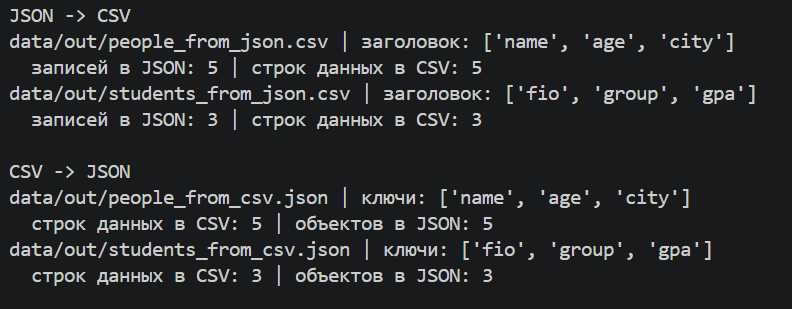
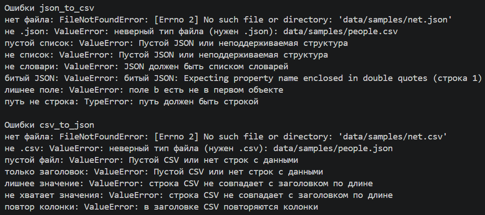
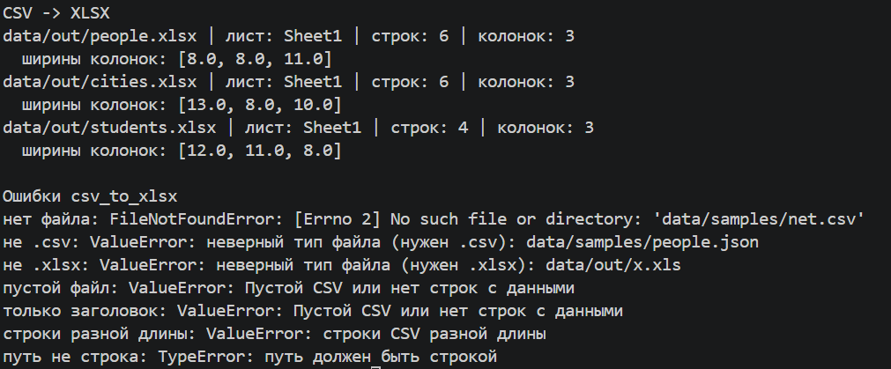
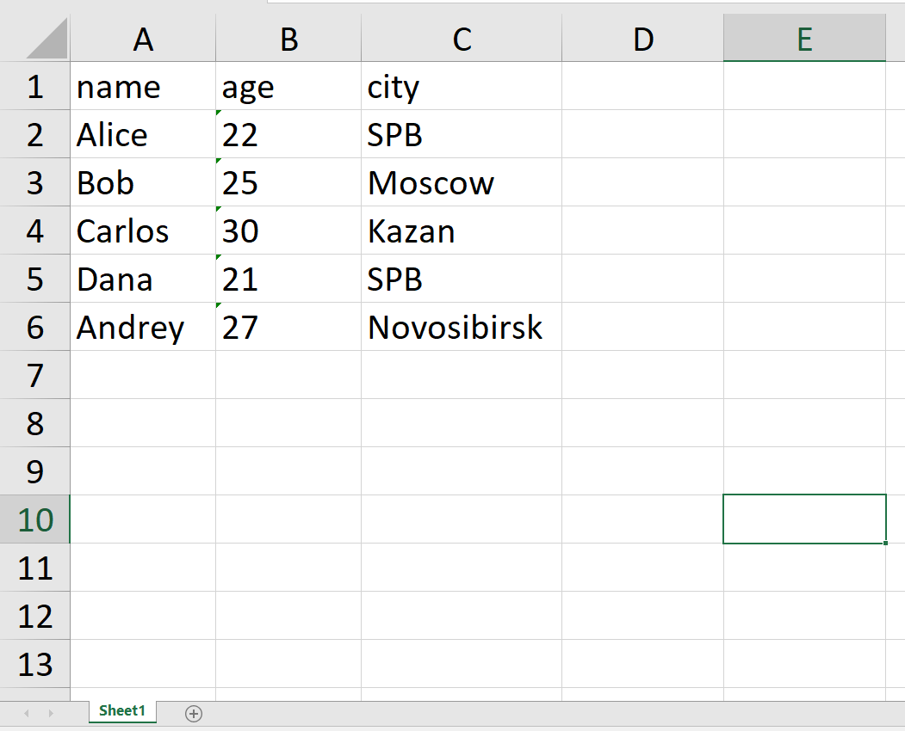
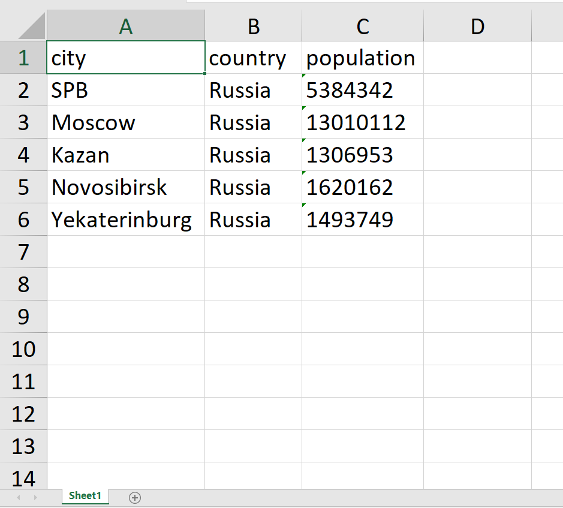

## ЛР5 — JSON и конвертации (JSON, CSV, XLSX)

### **Запуск**

Все команды из корня репозитория.

```
pip install -r requirements.txt
python -m src.lab05.make_samples
python -m src.lab05.json_csv
python -m src.lab05.csv_xlsx
```

make_samples создаёт примеры в data/samples/, в том числе data/samples/bad/ с некорректными файлами для проверки ошибок. json_csv и csv_xlsx запускают проверки всех сценариев, результаты пишутся в data/out/.

### **Форматы и допущения**

- JSON: список словарей. CSV: разделитель запятая, первая строка заголовок. Кодировка везде UTF-8.
- json_to_csv: колонки берутся из ключей первого объекта, порядок как в нём. Если в другом объекте поля нет, ячейка пустая. Если есть поле, которого нет в первом объекте, ValueError. Вложенные списки и словари не поддерживаются.
- csv_to_json: все значения остаются строками (например "4.5"). JSON пишется с ensure_ascii=False и indent=2.
- CSV, в котором есть только заголовок, считается пустым (ValueError).
- csv_to_xlsx: лист Sheet1, значения записываются как текст, ширина колонки равна длине самого длинного значения, но не меньше 8.
- Нет файла: FileNotFoundError. Неверное расширение, пустой или неподходящий вход: ValueError. Путь не строка: TypeError.
- Если проверка не прошла, выходной файл не создаётся.

### **Сценарий 1. JSON в CSV**



### **Сценарий 2. CSV в JSON**


### **Ошибки JSON и CSV**



### **Сценарий 3. CSV в XLSX**





