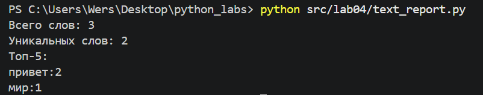
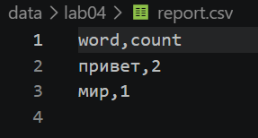
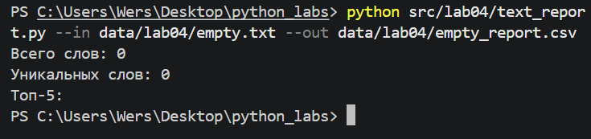
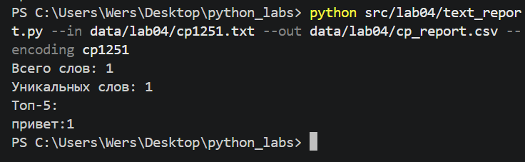
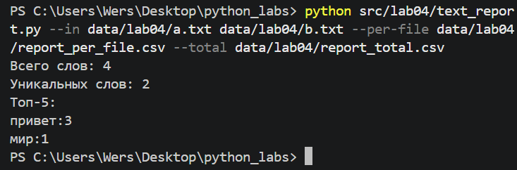
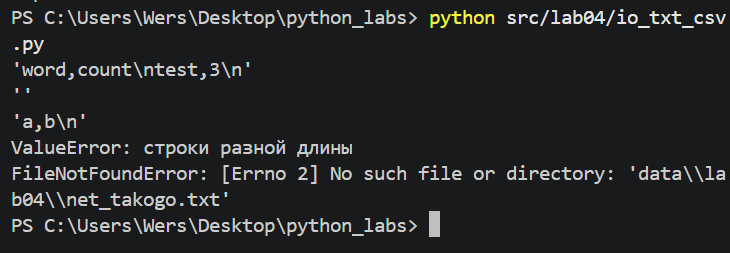
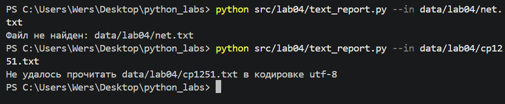

## ЛР4 — Файлы: TXT/CSV и отчёты по тексту

### **Запуск**

Все команды запускаются из корня репозитория.

```
python src/lab04/text_report.py
python src/lab04/text_report.py --in data/lab04/input.txt --out data/lab04/report.csv
```

Параметры: `--in` (один или несколько файлов), `--out` (то же, что `--total`), `--per-file`, `--encoding`. По умолчанию читается `data/lab04/input.txt`, отчёт пишется в `data/lab04/report.csv`.

### **Кодировки**

Файлы читаются и пишутся в UTF-8. Если входной файл в другой кодировке, её нужно указать: `--encoding cp1251`. Если кодировка не подошла, скрипт пишет сообщение и завершается с кодом 1. CSV-отчёты всегда пишутся в UTF-8.

### **Пустой вход и ошибки**

Пустой файл даёт `report.csv` только с заголовком `word,count`. Если входной файл не найден, скрипт печатает сообщение и завершается с кодом 1.

Файл читается целиком. Для очень больших файлов в реальной работе лучше читать построчно.

### **Тест-кейс A. Один файл**





### **Тест-кейс B. Пустой файл**



### **Тест-кейс C. Кодировка cp1251**



### **Тест-кейс D★. Несколько файлов**



### **Мини-тесты модуля io_txt_csv.py**



### **Ошибки: нет файла и неверная кодировка**

