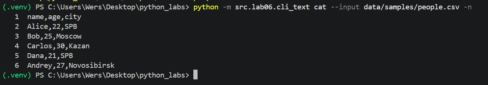
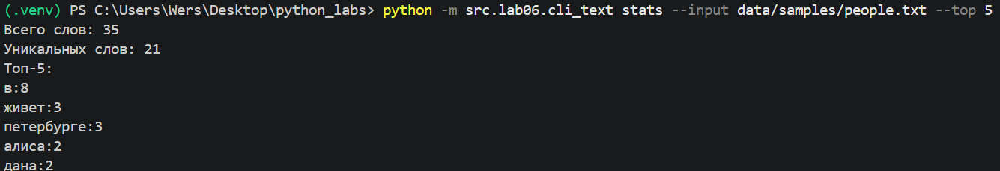
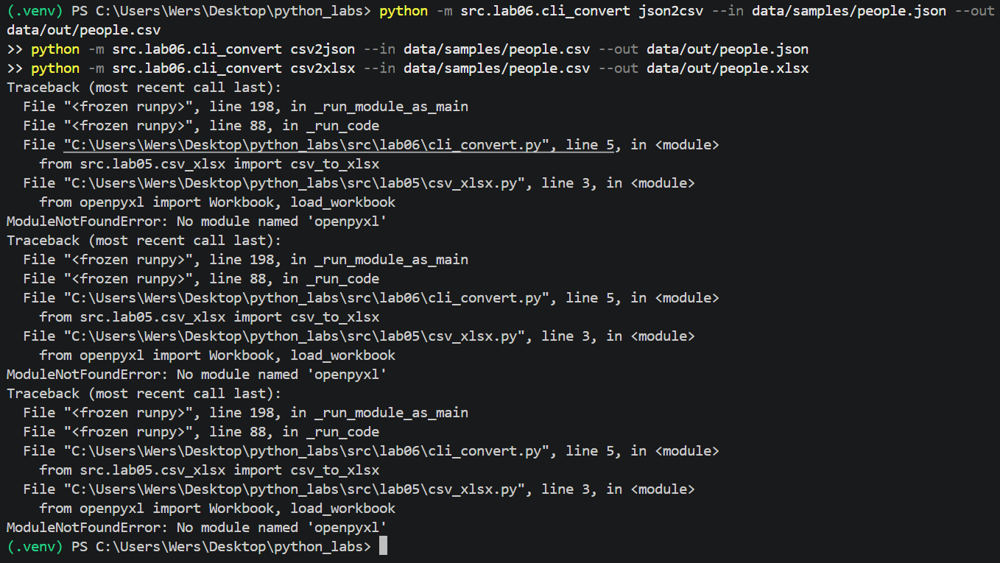
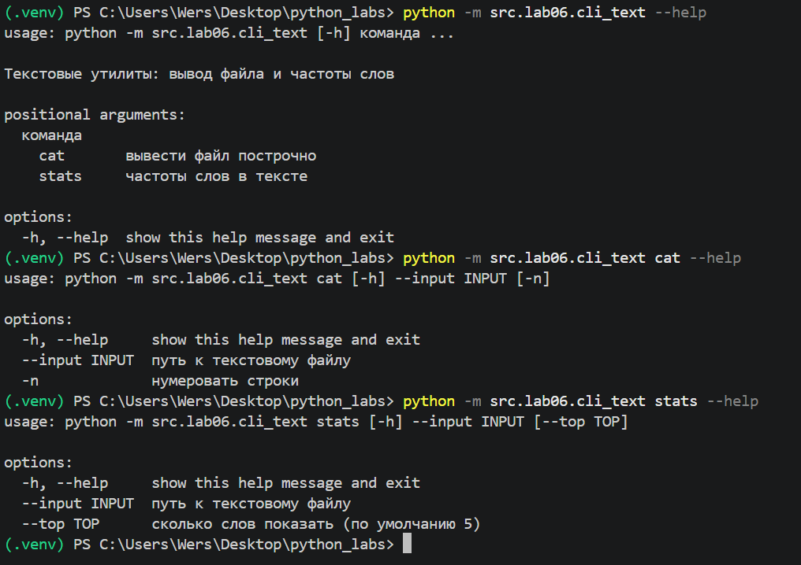
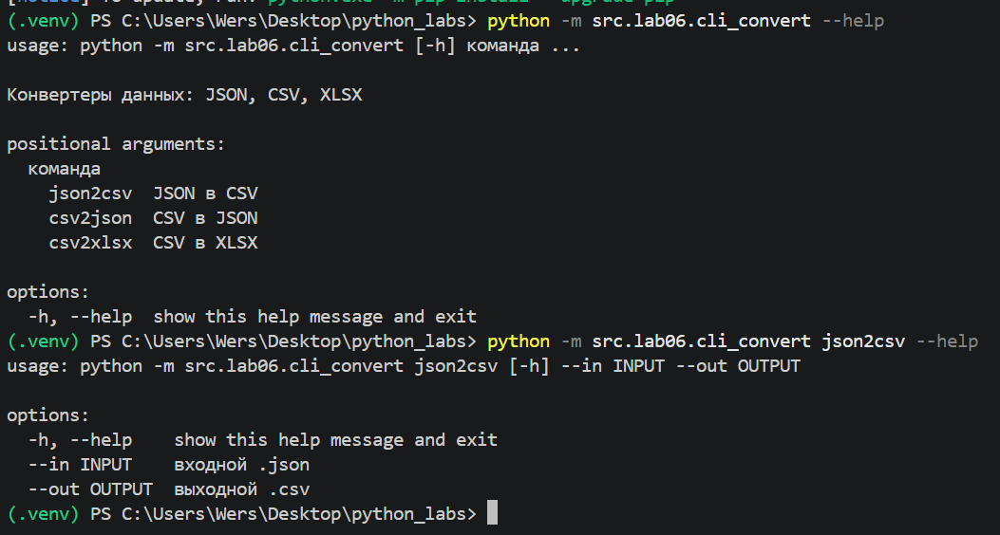
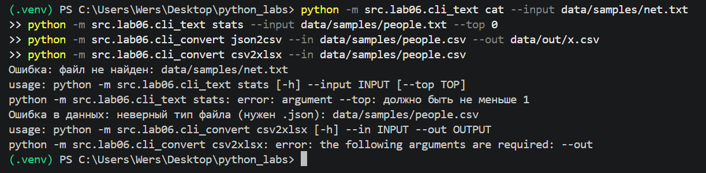

## ЛР6 — CLI-утилиты с argparse

Все команды запускаются из корня репозитория.

### **cli_text.py**

| Команда | Параметры | Что делает |
|---|---|---|
| `cat` | `--input` путь, `-n` | выводит файл построчно, с `-n` нумерует строки |
| `stats` | `--input` путь, `--top` число (по умолчанию 5) | всего слов, уникальных слов и самые частые слова |

### **cli_convert.py**

| Команда | Параметры | Что делает |
|---|---|---|
| `json2csv` | `--in` .json, `--out` .csv | JSON в CSV |
| `csv2json` | `--in` .csv, `--out` .json | CSV в JSON |
| `csv2xlsx` | `--in` .csv, `--out` .xlsx | CSV в XLSX |

Конвертеры используют функции из ЛР5. Для csv2xlsx нужен openpyxl из requirements.txt.

### **Ошибки**

- Нет входного файла: сообщение в stderr, код выхода 1.
- Неверное расширение или пустой файл: сообщение из ЛР5, код выхода 1.
- Неверные или пропущенные аргументы (например `--top 0` или нет `--out`): ошибка argparse, код выхода 2.

### **cat с нумерацией**

### **stats**

### **Конвертации**

### **Справка --help**

### **Ошибки**

