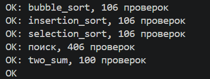
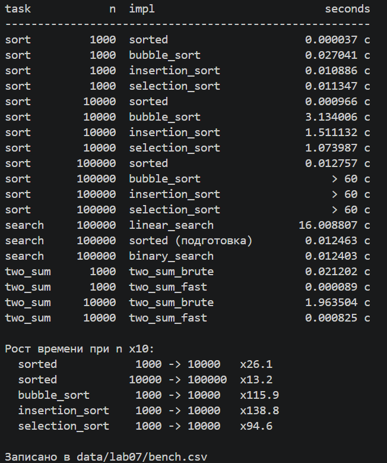

## ЛР7 — Поиск, сортировка и измерение времени

### **Запуск**

```
python -m src.lab07.check
python -m src.lab07.bench
```

### **Проверка против эталона (check.py)**



Сортировки проверялись на 106 списках каждая: 6 заданных вручную (пустой, из одного элемента, с повторами, с отрицательными) и 100 случайных длиной от 0 до 50 со значениями от -100 до 100. Результат сравнивался со sorted, отдельно проверялось, что исходный список не изменился. Поиск: 406 проверок, linear_search сравнивался с list.index (и -1 с ValueError), binary_search проверялся на отсортированных списках, на крайних элементах и на числах, которых нет. two_sum: 100 проверок, оба способа дают пару с нужной суммой или оба None. На итоговом коде расхождений нет. Чтобы убедиться, что проверка вообще ловит ошибки, я подставил неправильную сортировку (сравнение чисел как строк) и сортировку, которая меняет исходный список: обе упали на первом же расхождении с AssertionError и данными в сообщении.

### **Бенчмарк (data/lab07/bench.csv)**

```
task,n,impl,seconds
sort,1000,sorted,0.000037
sort,1000,bubble_sort,0.027041
sort,1000,insertion_sort,0.010886
sort,1000,selection_sort,0.011347
sort,10000,sorted,0.000966
sort,10000,bubble_sort,3.134006
sort,10000,insertion_sort,1.511132
sort,10000,selection_sort,1.073987
sort,100000,sorted,0.012757
sort,100000,bubble_sort,> 60
sort,100000,insertion_sort,> 60
sort,100000,selection_sort,> 60
search,100000,linear_search,16.008807
search,100000,sorted (подготовка),0.012463
search,100000,binary_search,0.012403
two_sum,1000,two_sum_brute,0.021202
two_sum,1000,two_sum_fast,0.000089
two_sum,10000,two_sum_brute,1.963504
two_sum,10000,two_sum_fast,0.000825
```



Квадратичные сортировки на n = 100 000 не запускались: по росту в ~100 раз они заняли бы больше 60 с, в таблице это отмечено как "> 60". Данные одинаковые для всех алгоритмов (random.seed(42)), время это минимум из нескольких повторов timeit. Перед замером результат каждой сортировки сравнивался со sorted.

### **Выводы**

Пузырёк, вставки и выбор делают порядка n^2 сравнений: два вложенных цикла по списку. Если n растёт в 10 раз, шагов становится в 100 раз больше, и замеры это подтверждают: при переходе от 1 000 к 10 000 время выросло в 115.9 раза (пузырёк), 138.8 (вставки) и 94.6 (выбор). sorted работает за n log n: при росте n с 10 000 до 100 000 его время выросло в 13.2 раза, то есть в 10 раз за счёт n и ещё немного за счёт log n. На переходе с 1 000 до 10 000 получилось 26.1, но при n = 1 000 sorted работает всего 37 микросекунд, и на таком малом времени сильно влияют накладные расходы и помехи, поэтому этот замер менее точный. Кроме того, sorted написан на C, поэтому он быстрее и при одинаковом n, но главное различие именно в порядке роста.

Бинарный поиск каждым шагом отбрасывает половину отрезка, поэтому на 100 000 элементов ему нужно около 17 шагов вместо 100 000 у линейного. Но он работает только на отсортированном списке: на неотсортированном он не падает, а молча даёт неверный ответ. Поэтому к его времени нужно добавить сортировку. В моих замерах 10 000 запросов линейным поиском заняли 16.01 с, а сортировка и 10 000 бинарных поисков вместе 0.025 с, примерно в 640 раз быстрее. Сортировка (n log n) делается один раз и окупается, когда запросов много, а для одного-двух запросов проще пройти список линейно. То же с two_sum: перебор пар это n^2, а словарь даёт один проход, и на n = 10 000 two_sum_fast оказался примерно в 2 400 раз быстрее (1.96 с против 0.0008 с).