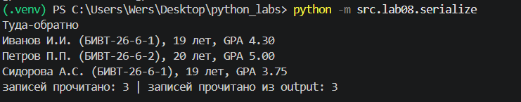
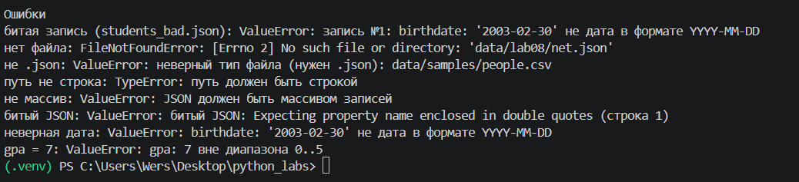

## ЛР8 — Модель данных без классов: запись Student как словарь, валидация и сериализация

### **Запуск**

Все команды из корня репозитория.

```
python -m src.lab08.serialize
```

Скрипт читает data/lab08/students_input.json, печатает записи через format_student, сохраняет их в data/lab08/students_output.json и затем проверяет все сценарии ошибок.

### **Структура записи**

Запись это словарь с фиксированным набором ключей. Перечень ключей лежит в константе `STUDENT_FIELDS = ("fio", "birthdate", "group", "gpa")`, любая функция может на неё полагаться.

```
{"fio": "Иванов Иван Иванович", "birthdate": "2007-05-14", "group": "БИВТ-26-6-1", "gpa": 4.3}
```

| Поле | Тип | Правило |
|------|-----|---------|
| fio | str | после strip() непустая |
| birthdate | str | формат YYYY-MM-DD, дата существует и не в будущем |
| group | str | после strip() непустая |
| gpa | float | число от 0 до 5, int допустим и приводится к float, bool не допустим |

### **Функции (models.py)**

- `make_student(fio, birthdate, group, gpa)` конструктор: проверяет каждое поле и возвращает новый словарь. Строки сохраняются без пробелов по краям, gpa всегда float.
- `validate_student(rec)` проверяет готовый словарь: что это словарь, что набор ключей ровно `STUDENT_FIELDS` (в ошибке указано, чего не хватает и что лишнее), затем значение каждого поля.
- `student_age(rec, today=None)` полных лет на дату today (по умолчанию сегодня). Из разницы годов вычитается 1, если день рождения в этом году ещё не наступил: сравниваются кортежи (месяц, день).
- `format_student(rec)` красивый вывод, например `Иванов И.И. (БИВТ-26-6-1), 19 лет, GPA 4.30`. Инициалы берутся как в ЛР1 и ЛР2, слово «год / года / лет» подбирается по числу.
- `student_to_dict(rec)` сначала валидирует запись, затем возвращает копию (новый словарь), а не тот же объект. Иначе два имени указывали бы на один словарь, как в ЛР3.
- `student_from_dict(d)` десериализация: проверяет, что d словарь и что все нужные ключи есть, берёт ровно эти ключи (лишние игнорируются) и прогоняет через `make_student`.

Ошибка валидации всегда `ValueError`, из сообщения понятно, какое поле и почему не подошло. Дата проверяется через `date.fromisoformat`, потому что регулярка пропустила бы несуществующую `2003-02-30`.

### **Функции (serialize.py)**

- `students_to_json(students, path)` проверяет путь и каждую запись, затем сохраняет массив объектов (`ensure_ascii=False`, `indent=2`). Если какая-то запись неверная, файл не создаётся.
- `students_from_json(path)` читает JSON-массив и каждый объект превращает в запись через `student_from_dict`.

### **Политика битых записей: strict**

Первая же битая запись останавливает чтение: `ValueError` с номером записи (с 0) и причиной. Выбрана strict, потому что молча пропущенная запись это потерянные данные, программа, которая продолжает работу с неверными данными, хуже программы, которая упала. Остальные ошибки: нет файла `FileNotFoundError`, путь не строка `TypeError`, не .json, битый JSON и JSON не массив `ValueError`. Пустой массив даёт пустой список.

### **Примеры JSON до и после**

До (students_input.json, у второго студента gpa целое число):

```
{
  "fio": "Петров Пётр Петрович",
  "birthdate": "2006-11-02",
  "group": "БИВТ-26-6-2",
  "gpa": 5
}
```

После (students_output.json, после чтения и записи gpa стал float):

```
{
  "fio": "Петров Пётр Петрович",
  "birthdate": "2006-11-02",
  "group": "БИВТ-26-6-2",
  "gpa": 5.0
}
```

Битая запись (students_bad.json): у второго студента дата `2003-02-30`, у третьего `gpa` равно 7.

### **Сценарий 1. Записи туда-обратно**



### **Сценарий 2. Ошибки**

